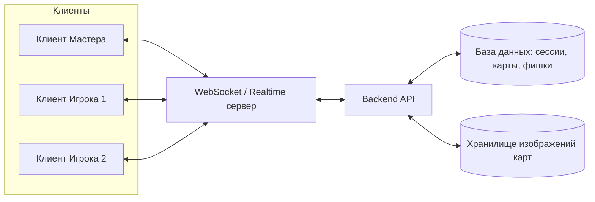

# Системная аналитика сервиса «Интерактивная карта для настольной ролевой игры (DnD)»

## 1. Назначение документа

Документ описывает функциональные и нефункциональные требования, роли пользователей, сценарии использования и модель данных для сервиса, позволяющего проводить партии в настольную ролевую игру (DnD и подобные) с использованием интерактивной карты: загрузка изображения локации, наложение сетки, размещение и перемещение фишек персонажей и монстров.

## 2. Цели и ценность сервиса

- Дать Мастеру инструмент для быстрой визуализации боевых сцен и локаций без ручного черчения сетки.
- Дать Игрокам простой и предсказуемый способ управлять положением своего персонажа на карте в реальном времени.
- Синхронизировать состояние карты у всех участников сессии (WYSIWYG для всех).

## 3. Роли пользователей

| Роль | Описание | Способ получения роли |
|---|---|---|
| **Мастер (DM)** | Ведущий партии. Управляет картой, сеткой, всеми фишками мобов/NPC. | Первый, кто создаёт сессию, либо явно выбирает роль «Мастер» при входе. |
| **Игрок** | Участник партии. Управляет только своим персонажем. | Присоединяется к существующей сессии по ссылке/коду, роль по умолчанию — «Игрок». |

Ограничение: в рамках одной игровой сессии роль «Мастер» может занимать только один пользователь (эксклюзивная роль до тех пор, пока сессия активна или пока Мастер явно не передаст роль).

## 4. Функциональные требования по ролям

### 4.1. Общие (для всех участников)
- FR-01. Вход в сессию по коду/ссылке приглашения.
- FR-02. Выбор роли при входе: занять роль Мастера (если свободна) или войти как Игрок.
- FR-03. Просмотр карты в реальном времени с отображением всех изменений, вносимых Мастером и Игроками.
- FR-04. Синхронизация изменений между всеми клиентами с минимальной задержкой (см. НФТ).

### 4.2. Мастер
- FR-10. Создание игровой сессии.
- FR-11. Загрузка произвольного изображения в качестве карты/фона (форматы: JPG, PNG, WebP).
- FR-12. Наложение сетки (grid) поверх изображения:
  - FR-12.1. Включение/выключение отображения сетки.
  - FR-12.2. Изменение масштаба сетки (размер ячейки) с привязкой к пикселям изображения.
  - FR-12.3. Смещение сетки по осям X/Y для точной подгонки под рисунок карты.
  - FR-12.4. Сохранение выбранных параметров сетки для конкретной карты.
- FR-13. Управление изображением карты: масштабирование (zoom) и панорамирование области просмотра.
- FR-14. Размещение иконок мобов/NPC на карте (drag&drop или клик для установки).
- FR-15. Перемещение уже размещённых иконок мобов по карте, в т.ч. с привязкой перемещения к ячейкам сетки (snap-to-grid, опционально — свободное перемещение).
- FR-16. Удаление иконки моба с карты.
- FR-17. Управление видимостью: скрытие/показ конкретных иконок мобов от Игроков (Fog of War / скрытые враги — опционально, если входит в объём).
- FR-18. Смена карты в рамках сессии (загрузка новой картинки взамен текущей).
- FR-19. Просмотр списка всех фишек на карте (мобы + персонажи игроков) и их текущих координат.

### 4.3. Игрок
- FR-30. Присоединение к сессии, созданной Мастером.
- FR-31. Создание/выбор своей иконки персонажа (базовый набор иконок или собственная загрузка — уточнить объём MVP).
- FR-32. Размещение своей иконки персонажа на карте (однократно при входе или по разрешению Мастера).
- FR-33. Перемещение только своей иконки персонажа по карте.
- FR-34. Игрок не имеет доступа к операциям над иконками мобов и настройками карты/сетки (запрет на уровне интерфейса и на уровне бэкенда).

## 5. Пользовательские сценарии (Use Cases)

**UC-1. Мастер начинает партию**
1. Пользователь заходит в сервис, создаёт новую сессию.
2. Система назначает пользователю роль Мастера, генерирует код/ссылку приглашения.
3. Мастер загружает изображение карты.
4. Мастер настраивает сетку (масштаб, смещение) до визуального совпадения с рисунком карты.
5. Карта готова к игре, Мастер делится ссылкой с игроками.

**UC-2. Игрок присоединяется и ставит персонажа**
1. Игрок переходит по ссылке/вводит код сессии.
2. Система назначает роль Игрок.
3. Игрок видит текущую карту с сеткой и уже размещёнными объектами.
4. Игрок размещает свою иконку персонажа в выбранной клетке.
5. В дальнейшем игрок перетаскивает свою иконку при перемещении персонажа по сюжету/бою.

**UC-3. Мастер управляет боевой сценой**
1. Мастер загружает карту подземелья/локации боя.
2. Мастер расставляет иконки мобов в нужных точках.
3. По ходу боя Мастер перемещает иконки мобов, при необходимости удаляет «убитых» мобов.
4. Все изменения мгновенно видны игрокам.

**UC-4. Смена локации**
1. Мастер загружает новое изображение карты.
2. Прежние иконки мобов и персонажей сбрасываются либо переносятся (требует уточнения бизнес-логики: сброс позиций или сохранение списка персонажей с необходимостью повторной расстановки).

## 6. Открытые вопросы для уточнения (требуют решения перед разработкой)

1. Максимальное число одновременных участников в одной сессии?
2. Нужна ли персистентность сессий (сохранение карты и позиций между заходами) или это одноразовая онлайн-сессия?
3. Нужен ли режим «тумана войны» (скрытие частей карты/мобов от игроков)?
4. Может ли Мастер передать свою роль другому участнику или роль назначается только один раз?
5. Может ли у Игрока быть больше одного персонажа на карте (например, компаньон/фамильяр)?
6. Ограничения на размер и вес загружаемого изображения карты?
7. Нужна ли история действий/лог перемещений для отладки спорных игровых моментов?
8. Требуется ли голосовая/текстовая коммуникация внутри сервиса, или это исключительно визуальный модуль поверх стороннего голосового чата?

## 7. Нефункциональные требования (НФТ)

- **NFR-01. Реальное время.** Изменения на карте должны доставляться другим клиентам с задержкой не более 200–300 мс (WebSocket-соединение).
- **NFR-02. Согласованность состояния.** При подключении нового клиента (или переподключении) он должен получать актуальное полное состояние карты (изображение, сетка, все фишки).
- **NFR-03. Разграничение прав доступа.** Проверка роли должна выполняться на сервере, а не только скрываться в интерфейсе клиента, чтобы Игрок не мог технически подвинуть чужую фишку или моба.
- **NFR-04. Производительность рендеринга.** Плавное масштабирование/панорамирование карты и перетаскивание фишек без визуальных лагов, в т.ч. на мобильных устройствах.
- **NFR-05. Кроссплатформенность.** Работа в браузере на десктопе и планшете/смартфоне (за столом игроки часто используют разные устройства).
- **NFR-06. Отказоустойчивость сессии.** Кратковременный обрыв соединения не должен приводить к потере состояния карты — при переподключении клиент восстанавливает актуальную картину.

## 8. Укрупнённая модель данных

**Session (Игровая сессия)**
- id
- invite_code
- master_user_id
- current_map_id
- created_at

**Map (Карта)**
- id
- session_id
- image_url
- grid_scale (размер ячейки)
- grid_offset_x, grid_offset_y
- grid_visible (bool)

**Token (Фишка на карте — обобщённая сущность для моба и персонажа)**
- id
- map_id
- type (enum: "monster" | "player_character")
- owner_user_id (для типа player_character; для monster — null или master_user_id)
- icon_url
- position_x, position_y (в координатах карты либо в координатах ячейки сетки)
- visible_to_players (bool, если предусмотрен туман войны)

**User (Участник)**
- id
- session_id
- role (enum: "master" | "player")
- display_name

## 9. Матрица прав доступа

| Действие | Мастер | Игрок |
|---|---|---|
| Загрузка/смена карты | ✅ | ❌ |
| Настройка сетки (масштаб, смещение) | ✅ | ❌ |
| Размещение/перемещение иконок мобов | ✅ | ❌ |
| Удаление иконок мобов | ✅ | ❌ |
| Размещение своего персонажа | ❌ (не имеет своего перса) | ✅ |
| Перемещение своего персонажа | ❌ | ✅ (только своего) |
| Перемещение чужого персонажа | ❌ | ❌ |
| Просмотр карты | ✅ | ✅ |

## 10. Укрупнённая архитектура (высокоуровнево)

- **Backend API** — управление сессиями, авторизация ролей, валидация прав на действия.
- **Realtime-слой (WebSocket)** — рассылка событий изменения карты/фишек всем подключённым клиентам сессии.
- **Хранилище файлов** — для загружаемых изображений карт и иконок.
- **База данных** — хранение сессий, карт, параметров сетки, фишек и их координат.

## 11. Критерии готовности MVP

1. Пользователь может создать сессию и стать Мастером.
2. Другой пользователь может присоединиться как Игрок по ссылке.
3. Мастер может загрузить изображение и настроить сетку (масштаб + смещение).
4. Мастер может добавлять, перемещать и удалять иконки мобов.
5. Игрок может разместить и перемещать только свою иконку персонажа.
6. Все изменения синхронно видны всем участникам сессии.
